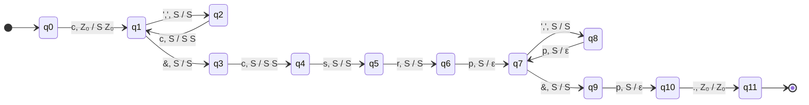

# Etapa 3 — Autômato de pilha (AP) para L1

## Definição formal

M = (Q, Σ, Γ, δ, q0, Z₀, F)

- **Estados:** Q = {q0, q1, …, q11} (12 estados)
- **Alfabeto de entrada:** Σ = {`o`, `a`, `x`, `y`, `O`, `A`, `X`, `Y`, `,`, `&`, `s`, `r`, `.`}
- **Alfabeto da pilha:** Γ = {S, Z₀}. `S` é um sujeito que ainda não foi pareado com um predicativo, e `Z₀` é o fundo da pilha.
- **Configuração inicial:** (q0, w, Z₀): estado q0, cabeça de leitura no 1º símbolo de w, pilha só com Z₀.
- **Estados finais:** F = {q11}
- **Critério de aceitação:** por **estado final**. A cadeia é aceita se, **depois de consumir toda a entrada**, o AP está em q11. Se faltar uma transição antes do fim, ou se a entrada acabar fora de q11, a cadeia é rejeitada.

Notação: c ∈ C = {o,a,x,y} (sujeito) e p ∈ P = {O,A,X,Y} (predicativo). Uma transição δ(q, a, T) = (q', γ) significa: no estado q, lendo `a` com `T` no topo, vai para q' e troca o topo `T` pela cadeia γ (γ = ε desempilha; γ = `SS` empilha um S; γ = `S` ou `Z₀` mantém).

## Transições

| # | δ(estado, lê, topo) | = (novo estado, escreve no topo) | Ação | Papel |
|---|---|---|---|---|
| 1 | δ(q0, c, Z₀) | (q1, S Z₀) | empilha | 1º sujeito |
| 2 | δ(q1, `,`, S) | (q2, S) | — | vírgula entre sujeitos |
| 3 | δ(q1, `&`, S) | (q3, S) | — | "e" antes do último sujeito |
| 4 | δ(q2, c, S) | (q1, S S) | empilha | sujeito depois da vírgula |
| 5 | δ(q3, c, S) | (q4, S S) | empilha | último sujeito |
| 6 | δ(q4, `s`, S) | (q5, S) | — | "são" |
| 7 | δ(q5, `r`, S) | (q6, S) | — | "respectivamente" |
| 8 | δ(q6, p, S) | (q7, ε) | desempilha | 1º predicativo |
| 9 | δ(q7, `,`, S) | (q8, S) | — | vírgula entre predicativos |
| 10 | δ(q7, `&`, S) | (q9, S) | — | "e" antes do último predicativo |
| 11 | δ(q8, p, S) | (q7, ε) | desempilha | predicativo depois da vírgula |
| 12 | δ(q9, p, S) | (q10, ε) | desempilha | último predicativo |
| 13 | δ(q10, `.`, Z₀) | (q11, Z₀) | — | fim: todos os sujeitos pareados |

As linhas com c ou p valem para cada uma das 4 classes, o que dá **31 transições** no total. Qualquer combinação (estado, símbolo, topo) fora da tabela leva à rejeição.

## Diagrama

Rótulo das arestas: `lê, topo / escreve`.

No relatório o diagrama será refeito em TikZ.

## Por que o AP reconhece L1 = L(G)

**Invariante da pilha.** Depois de ler um prefixo com k sujeitos e j predicativos, a pilha é Sᵏ⁻ʲ Z₀. Cada sujeito empilha um S (transições 1, 4 e 5), cada predicativo desempilha um (8, 11 e 12), e nenhuma outra transição mexe na quantidade.

**Formato.** Ignorando a pilha, os estados formam um autômato finito para o formato das listas:
- q0 → q1 ⇄ q2 → q3 → q4 lê `c(,c)*&c`, a lista de sujeitos;
- q4 → q5 → q6 lê `sr`;
- q6 → q7 ⇄ q8 → q9 → q10 → q11 lê `p(,p)*&p.`, a lista de predicativos.

Só se chega a q4 passando por `&` e depois de pelo menos um sujeito em q0, então **n ≥ 2** sujeitos.

**Contagem.** A única transição para o estado final é a 13, que exige Z₀ no topo. Pelo invariante, isso significa k = j: há tantos predicativos quanto sujeitos.

**(⊆)** Se M aceita w, então w passou pelo formato e terminou com k = j, logo w ∈ L1.
**(⊇)** Se w ∈ L1 com n itens, a pilha nunca fica sem S antes da hora. Depois do j-ésimo predicativo restam n − j ≥ 1 S enquanto j < n, então as transições 9, 10, 11 e 12 sempre encontram `S` no topo. O último predicativo deixa Z₀ e o `.` leva a q11. Logo M aceita w.

**Relação com as produções da GLC:**

| Produção | No AP |
|---|---|
| (2) L → C , L , P | um laço de **empilhar** (q1 → q2 → q1) e, mais adiante, um laço de **desempilhar** (q7 → q8 → q7) |
| (3) L → C & C s r P | q1 →`&` q3 → q4 →`s` q5 →`r` q6 → q7: o centro da frase, onde a pilha para de crescer e começa a diminuir |
| (1) S → L & P . | q7 →`&` q9 → q10 →`.` q11: o último predicativo e o ponto final |
| (4)–(11) C → …, P → … | a transição lê qualquer uma das 4 classes da mesma forma: o AP não distingue classes |

A pilha é LIFO: o S do 1º sujeito fica no fundo e só sai com o último predicativo. O pareamento que o AP faz é **aninhado**, como o da GLC. É por isso que nem a GLC nem o AP conseguem verificar a concordância **cruzada**, que fica para o ALL.

## Determinismo e terminação

- **Determinístico:** para cada (estado, símbolo, topo) há no máximo uma transição, e não há transições ε. O simulador não precisa explorar alternativas.
- **Termina sempre:** como não há transições ε, cada passo consome exatamente um símbolo. Para uma entrada de comprimento m, o AP para em no máximo m passos, aceitando ou rejeitando por falta de transição.

## Rastreamentos

Cada linha mostra a configuração **antes** do passo. A posição é o índice (a partir de 1) do símbolo lido.

### Cenário 1 — `o,a,x,y&osrO,A,X,Y&O.` → ACEITA

| Passo | Estado | Posição | Lê | Pilha (topo à esquerda) | Transição |
|---|---|---|---|---|---|
| 0 | q0 | 1 | `o` | Z₀ | → q1, empilha S |
| 1 | q1 | 2 | `,` | SZ₀ | → q2 |
| 2 | q2 | 3 | `a` | SZ₀ | → q1, empilha S |
| 3 | q1 | 4 | `,` | SSZ₀ | → q2 |
| 4 | q2 | 5 | `x` | SSZ₀ | → q1, empilha S |
| 5 | q1 | 6 | `,` | SSSZ₀ | → q2 |
| 6 | q2 | 7 | `y` | SSSZ₀ | → q1, empilha S |
| 7 | q1 | 8 | `&` | SSSSZ₀ | → q3 |
| 8 | q3 | 9 | `o` | SSSSZ₀ | → q4, empilha S |
| 9 | q4 | 10 | `s` | SSSSSZ₀ | → q5 |
| 10 | q5 | 11 | `r` | SSSSSZ₀ | → q6 |
| 11 | q6 | 12 | `O` | SSSSSZ₀ | → q7, desempilha |
| 12 | q7 | 13 | `,` | SSSSZ₀ | → q8 |
| 13 | q8 | 14 | `A` | SSSSZ₀ | → q7, desempilha |
| 14 | q7 | 15 | `,` | SSSZ₀ | → q8 |
| 15 | q8 | 16 | `X` | SSSZ₀ | → q7, desempilha |
| 16 | q7 | 17 | `,` | SSZ₀ | → q8 |
| 17 | q8 | 18 | `Y` | SSZ₀ | → q7, desempilha |
| 18 | q7 | 19 | `&` | SZ₀ | → q9 |
| 19 | q9 | 20 | `O` | SZ₀ | → q10, desempilha |
| 20 | q10 | 21 | `.` | Z₀ | → q11 |
| 21 | **q11** | fim | — | Z₀ | **aceita**: entrada consumida e estado final |

### Cenário 2 — `o,a,x,y&osrO,A,X&Y.` → REJEITA

Os passos 0–15 são iguais aos do cenário 1, com 5 S empilhados. Como a lista de predicativos tem só 4 itens, o `&` aparece cedo:

| Passo | Estado | Posição | Lê | Pilha (topo à esquerda) | Transição |
|---|---|---|---|---|---|
| 16 | q7 | 17 | `&` | SSZ₀ | → q9 |
| 17 | q9 | 18 | `Y` | SSZ₀ | → q10, desempilha |
| 18 | q10 | 19 | `.` | **S**Z₀ | **δ(q10, `.`, S) não existe → rejeita** |

O `.` chegou com um S ainda na pilha: sobrou um sujeito sem predicativo.

### Cenário 3 — `o,a,x,y&osrO,A,O,Y&O.` → ACEITA

O rastreamento tem os mesmos estados e a mesma pilha do cenário 1, só que lendo `O` no passo 15 em vez de `X`. O AP aceita porque **não olha a classe**. O erro de número (*os meninos … médico*) só vai ser detectado pelo ALL.

### Outros casos de rejeição (para os testes)
- **Predicativos a mais**, por exemplo `o&asrO,A,X&Y.`: depois de 2 desempilhamentos o topo é Z₀ em q7, e δ(q7, `,`, Z₀) não existe.
- **Sem o "e"**, por exemplo `o,asrO,A.`: em q1, lendo `s`, não há transição.
- **Entrada vazia:** termina em q0, que não é final → rejeita.

## Conferência
Simulei a tabela acima em Python e comparei o resultado com a definição de L1:
- **testes exaustivos:** todas as cadeias de comprimento até 8 sobre {`o`,`O`,`,`,`&`,`s`,`r`,`.`}, 6.725.601 cadeias;
- **testes aleatórios:** 200.000 frases perturbadas sobre o alfabeto completo.

Não houve divergência. Os rastreamentos acima foram gerados pela mesma simulação.
