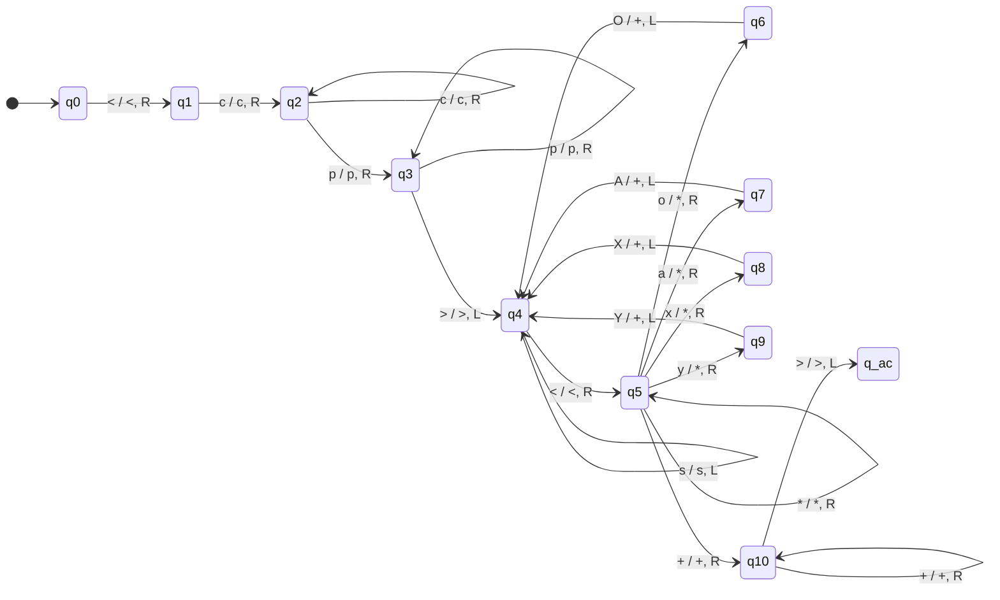

# Etapa 4 — Autômato linearmente limitado (ALL) para L2

## Linguagem

C = {`o`, `a`, `x`, `y`} (sujeitos), P = {`O`, `A`, `X`, `Y`} (predicativos) e h(o)=O, h(a)=A, h(x)=X, h(y)=Y.

L2 = { w · h(w) | w ∈ C⁺ }

**Regra de aceitação:** a cadeia é uma sequência não vazia de sujeitos seguida de uma sequência de predicativos de **mesmo tamanho**, em que o i-ésimo predicativo é da **mesma classe** (gênero e número) que o i-ésimo sujeito.

**Entrada do ALL na integração:** depois que o AP aceita, o programa retira a pontuação e as palavras fixas (`,` `&` `s` `r` `.`) e passa ao ALL só os sujeitos e os predicativos, na ordem. Por exemplo, `o,a,x,y&osrO,A,X,Y&O.` vira `oaxyoOAXYO`.

## L2 é sensível ao contexto e não é livre de contexto

**Não é livre de contexto.** Suponha que L2 seja LLC. Como as LLC são fechadas sob interseção com linguagens regulares, L' = L2 ∩ o⁺a⁺O⁺A⁺ = { oⁱ aʲ Oⁱ Aʲ | i, j ≥ 1 } também seria LLC. Seja p o comprimento de bombeamento e s = oᵖ aᵖ Oᵖ Aᵖ = uvxyz, com |vxy| ≤ p e |vy| ≥ 1.

- Os blocos `o` e `O` estão separados por p símbolos `a`, então vxy não toca os dois. O mesmo vale para `a` e `A`, separados por p símbolos `O`.
- Se v ou y contém dois símbolos diferentes, uv²xy²z sai da forma o⁺a⁺O⁺A⁺.
- Senão, o bombeamento muda a quantidade de um ou dois blocos vizinhos, sem mudar a do bloco "parceiro" (o↔O, a↔A). Então uv²xy²z ∉ L'.

Há contradição, logo L2 não é LLC. ∎

É a mesma estrutura das dependências cruzadas de Shieber (1985). Uma pilha só consegue parear de forma aninhada: quem entra por último sai primeiro.

**É sensível ao contexto.** O ALL abaixo reconhece L2, e as linguagens reconhecidas por ALLs são exatamente as sensíveis ao contexto (Kuroda, 1964).

## Definição formal

M = (Q, Σ, Γ, δ, q0, ⊲, ⊳, q_ac)

- **Estados:** Q = {q0, …, q10, q_ac}, ou seja, 11 estados de trabalho mais 1 de aceitação (12 estados)
- **Alfabeto de entrada:** Σ = C ∪ P = {`o`, `a`, `x`, `y`, `O`, `A`, `X`, `Y`}
- **Alfabeto da fita:** Γ = Σ ∪ {`*`, `+`, `<`, `>`}
  - `*` = sujeito já pareado
  - `+` = predicativo já pareado
  - `<` e `>` = marcadores de borda (⊲ e ⊳)
- **Configuração inicial:** a fita é `<` w `>`, com o cabeçote no `<` (posição 0) e estado q0
- **Aceitação:** chegar em q_ac. **Rejeição:** parar quando δ não está definida para o estado e o símbolo atuais. O simulador retorna a rejeição imediatamente e registra no rastreamento a configuração em que faltou a transição; não há um estado adicional de rejeição.

### Fita e limite de memória
- Para uma entrada de n símbolos, a fita tem **n células graváveis** (posições 1..n) e os **dois marcadores fixos** nas posições 0 e n+1.
- **Toda a memória de trabalho cabe nessas n células:** um símbolo pareado é **sobrescrito** por `*` ou `+`. Não há células extras.
- **Os marcadores nunca são alterados:** toda transição que lê `<` escreve `<` e move para a direita; toda transição que lê `>` escreve `>` e move para a esquerda. Assim o cabeçote fica sempre entre 0 e n+1.
- A classe do sujeito que está sendo pareado **não é escrita na fita**: ela fica no estado (q6–q9). Por isso há um estado de "carregar" para cada classe.

## Estados

| Estado | Fase | Papel |
|---|---|---|
| q0 | formato | no `<`, começa |
| q1 | formato | exige pelo menos um sujeito |
| q2 | formato | lê os sujeitos até o 1º predicativo |
| q3 | formato | lê os predicativos até o `>`. Se aparecer um sujeito, rejeita |
| q4 | ambas | volta ao `<` |
| q5 | pareamento | pula os `*` e marca o próximo sujeito com `*`. Se já não há sujeitos, vai para a verificação final |
| q6 | pareamento | carrega **o**: o 1º predicativo não pareado tem de ser `O` |
| q7 | pareamento | carrega **a**: tem de ser `A` |
| q8 | pareamento | carrega **x**: tem de ser `X` |
| q9 | pareamento | carrega **y**: tem de ser `Y` |
| q10 | verificação | depois do último sujeito, só pode haver `+` até o `>` |
| q_ac | parada | aceita |

## Transições

δ(estado, lê) = (novo estado, escreve, movimento). Na tabela, c ∈ C, p ∈ P e s é qualquer símbolo de Σ ∪ {`*`, `+`}.

| # | Transição | Papel |
|---|---|---|
| 1 | δ(q0, `<`) = (q1, `<`, R) | sai da borda esquerda |
| 2 | δ(q1, c) = (q2, c, R) | 1º sujeito |
| 3 | δ(q2, c) = (q2, c, R) | mais sujeitos |
| 4 | δ(q2, p) = (q3, p, R) | 1º predicativo |
| 5 | δ(q3, p) = (q3, p, R) | mais predicativos |
| 6 | δ(q3, `>`) = (q4, `>`, L) | formato ok: volta |
| 7 | δ(q4, s) = (q4, s, L) | anda para a esquerda |
| 8 | δ(q4, `<`) = (q5, `<`, R) | chegou à borda |
| 9 | δ(q5, `*`) = (q5, `*`, R) | pula sujeitos já pareados |
| 10 | δ(q5, `o`) = (q6, `*`, R) | marca o sujeito e carrega **o** |
| 11 | δ(q5, `a`) = (q7, `*`, R) | carrega **a** |
| 12 | δ(q5, `x`) = (q8, `*`, R) | carrega **x** |
| 13 | δ(q5, `y`) = (q9, `*`, R) | carrega **y** |
| 14 | δ(q5, `+`) = (q10, `+`, R) | não há mais sujeitos: verificação final |
| 15 | δ(qₖ, c) = (qₖ, c, R) e δ(qₖ, `+`) = (qₖ, `+`, R), para k = 6..9 | atravessa sujeitos e predicativos já pareados |
| 16 | δ(q6, `O`) = (q4, `+`, L) | concorda: marca e volta |
| 17 | δ(q7, `A`) = (q4, `+`, L) | concorda: marca e volta |
| 18 | δ(q8, `X`) = (q4, `+`, L) | concorda: marca e volta |
| 19 | δ(q9, `Y`) = (q4, `+`, L) | concorda: marca e volta |
| 20 | δ(q10, `+`) = (q10, `+`, R) | só pareados |
| 21 | δ(q10, `>`) = (q_ac, `>`, L) | **aceita** |
| — | qualquer outra combinação | **para e rejeita por falta de transição** |

Expandindo c, p e s, são **61 transições**.

### Por que cada rejeição acontece

| Onde para | O que leu | Significado |
|---|---|---|
| q1 | `>` ou um predicativo | entrada vazia ou sem sujeitos |
| q2 | `>` | não há predicativos |
| q3 | um sujeito | sujeito depois de predicativo: formato errado |
| q6–q9 | um predicativo de outra classe | **falta de concordância** (gênero ou número) |
| q6–q9 | `>` | **sobrou sujeito**: há menos predicativos do que sujeitos |
| q10 | um predicativo não pareado | **sobrou predicativo**: há mais predicativos do que sujeitos |

## Diagrama

Rótulo das arestas: `lê / escreve, movimento`.

Os laços de q6–q9 (`c` ou `+` / mesmo, R) não aparecem no diagrama para não poluir. No relatório ele será refeito em TikZ.

## Determinismo e terminação

- **Determinístico:** para cada (estado, símbolo) há no máximo uma transição.
- **Termina para toda entrada:**
  - **Fase de formato (q0–q3, depois q4):** só anda para a direita até o `>` e depois só para a esquerda até o `<`, em no máximo 2(n+1) passos.
  - **Fase de pareamento:** cada volta q5 → q6..q9 → q4 → q5 ou rejeita por falta de transição ou **marca duas células novas** (um `*` e um `+`). Uma célula marcada nunca volta a ser não marcada, então há no máximo n/2 voltas, cada uma com no máximo 2(n+1) passos.
  - **Verificação (q10):** só anda para a direita até o `>`.

  No total são O(n²) passos. O limite (n+2)² + n + 2 foi conferido na simulação para todas as entradas testadas.

## Rastreamentos

Cada linha resume os passos em que o ALL ficou no mesmo estado e mostra a **última configuração antes de sair dele**. O cabeçote está entre colchetes e a posição 0 é o `<`. Os rastreamentos passo a passo completos estão em [rastreamentos/all-cenario1.md](rastreamentos/all-cenario1.md) e [rastreamentos/all-cenario3.md](rastreamentos/all-cenario3.md).

### Cenário 1 — `oaxyoOAXYO` (vem de `o,a,x,y&osrO,A,X,Y&O.`) → ACEITA em 114 passos

| Passos | Estado | Fita | Cabeçote |
|---|---|---|---|
| 0 | q0 | `[<]oaxyoOAXYO>` | 0 |
| 1 | q1 | `<[o]axyoOAXYO>` | 1 |
| 2–6 | q2 | `<oaxyo[O]AXYO>` | 6 |
| 7–11 | q3 | `<oaxyoOAXYO[>]` | 11 |
| 12–22 | q4 | `[<]oaxyoOAXYO>` | 0 |
| 23 | q5 | `<[o]axyoOAXYO>` | 1 |
| 24–28 | q6 | `<*axyo[O]AXYO>` | 6 |
| 29–34 | q4 | `[<]*axyo+AXYO>` | 0 |
| 35–36 | q5 | `<*[a]xyo+AXYO>` | 2 |
| 37–41 | q7 | `<**xyo+[A]XYO>` | 7 |
| 42–48 | q4 | `[<]**xyo++XYO>` | 0 |
| 49–51 | q5 | `<**[x]yo++XYO>` | 3 |
| 52–56 | q8 | `<***yo++[X]YO>` | 8 |
| 57–64 | q4 | `[<]***yo+++YO>` | 0 |
| 65–68 | q5 | `<***[y]o+++YO>` | 4 |
| 69–73 | q9 | `<****o+++[Y]O>` | 9 |
| 74–82 | q4 | `[<]****o++++O>` | 0 |
| 83–87 | q5 | `<****[o]++++O>` | 5 |
| 88–92 | q6 | `<*****++++[O]>` | 10 |
| 93–102 | q4 | `[<]*****+++++>` | 0 |
| 103–108 | q5 | `<*****[+]++++>` | 6 |
| 109–113 | q10 | `<*****+++++[>]` | 11 |
| 114 | **q_ac** | `<*****++++[+]>` | 10 |

Como ler: a cada volta, q5 marca o sujeito mais à esquerda (`o` → `*`) e guarda a classe dele no estado (q6 = "estou levando um *o*"). O estado de carregar corre para a direita até o primeiro predicativo não pareado, confere a classe e o marca com `+`. Quando q5 encontra um `+` em vez de um sujeito, todos os sujeitos foram pareados, e q10 confirma que não sobrou nenhum predicativo.

### Cenário 3 — `oaxyoOAOYO` (vem de `o,a,x,y&osrO,A,O,Y&O.`) → REJEITA em 56 passos

| Passos | Estado | Fita | Cabeçote |
|---|---|---|---|
| 0 | q0 | `[<]oaxyoOAOYO>` | 0 |
| 1 | q1 | `<[o]axyoOAOYO>` | 1 |
| 2–6 | q2 | `<oaxyo[O]AOYO>` | 6 |
| 7–11 | q3 | `<oaxyoOAOYO[>]` | 11 |
| 12–22 | q4 | `[<]oaxyoOAOYO>` | 0 |
| 23 | q5 | `<[o]axyoOAOYO>` | 1 |
| 24–28 | q6 | `<*axyo[O]AOYO>` | 6 |
| 29–34 | q4 | `[<]*axyo+AOYO>` | 0 |
| 35–36 | q5 | `<*[a]xyo+AOYO>` | 2 |
| 37–41 | q7 | `<**xyo+[A]OYO>` | 7 |
| 42–48 | q4 | `[<]**xyo++OYO>` | 0 |
| 49–51 | q5 | `<**[x]yo++OYO>` | 3 |
| 52–56 | q8 | `<***yo++[O]YO>` | 8 |

No passo 56 o ALL está em q8 ("levando um *x*", masculino plural) e lê `O` (masculino singular). δ(q8, `O`) não existe, então o simulador **para e rejeita nessa configuração**. É o par *os meninos … médico*: o gênero bate, o número não.

## Conferência
Simulei a tabela acima em Python e comparei o resultado com a definição de L2:
- **testes exaustivos:** todas as cadeias de comprimento 0 a 7 sobre Σ, 2.396.745 cadeias;
- **testes aleatórios:** 50.000 cadeias perturbadas com até 30 símbolos.

Não houve divergência. Em todas, o cabeçote ficou dentro de [0, n+1] e o número de passos ficou abaixo de (n+2)² + n + 2. Os rastreamentos foram gerados pela mesma simulação.
